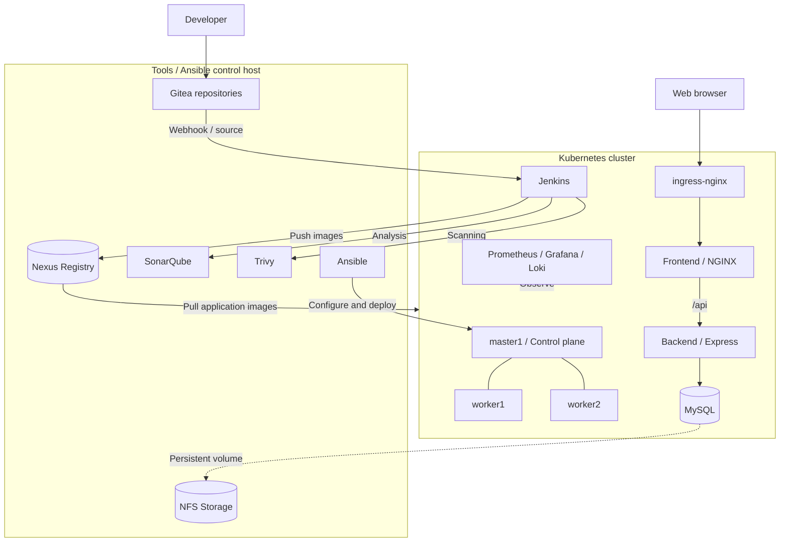
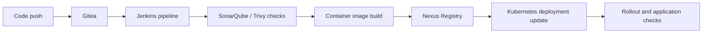

<div align="center">

# ☸️ Cloud-Native DevOps & DevSecOps Lab

### Kubernetes Infrastructure • CI/CD Automation • Security • Observability

**An end-to-end DevOps laboratory for deploying a containerized student management application on a multi-node Kubernetes cluster, using Ansible for infrastructure automation and Jenkins for continuous integration and delivery.**

<br>

<a href="https://www.ansible.com/"></a>&nbsp;&nbsp;
<a href="https://kubernetes.io/"></a>&nbsp;&nbsp;
<a href="https://www.docker.com/"></a>&nbsp;&nbsp;
<a href="https://www.jenkins.io/"></a>&nbsp;&nbsp;
<a href="https://prometheus.io/"></a>&nbsp;&nbsp;
<a href="https://grafana.com/"></a>&nbsp;&nbsp;
<a href="https://nodejs.org/"></a>&nbsp;&nbsp;
<a href="https://www.mysql.com/"></a>

<br><br>


</div>

---

## Overview

This repository demonstrates a **self-hosted DevOps platform**, from infrastructure provisioning and application delivery to security controls and operational monitoring. The environment is organized around a **one-control-plane, two-worker Kubernetes cluster**, supported by a separate **tools/automation host**.

The demo workload is a **student management application**:

- **Frontend:** static HTML/CSS/JavaScript served through NGINX.
- **Backend:** Node.js + Express REST API (`GET /health`, `GET /students`, `POST /students`).
- **Database:** MySQL, deployed in the Kubernetes `project` namespace.

> **Project status:** Educational lab / work in progress. This README documents components and configuration found in the repository; it does not imply that the entire stack has passed an end-to-end deployment test. See [Current limitations](#-current-limitations--next-steps) before running `site.yml`.

## Contents

- [Objectives](#-objectives)
- [Technology stack](#-technology-stack)
- [Infrastructure topology](#-infrastructure-topology)
- [Architecture](#-architecture)
- [CI/CD workflow](#-cicd-workflow)
- [Repository structure](#-repository-structure)
- [Prerequisites](#-prerequisites)
- [Deployment guide](#-deployment-guide)
- [Validation and troubleshooting](#-validation-and-troubleshooting)
- [Security practices](#-security-practices)
- [Current limitations & next steps](#-current-limitations--next-steps)

## Objectives

1. Automate Linux and Kubernetes setup using **Ansible roles and playbooks**.
2. Build and run a **multi-node Kubernetes cluster** with `kubeadm` and Flannel networking.
3. Containerize and deploy a **frontend, backend and MySQL** application.
4. Implement a self-hosted **CI/CD workflow** using Gitea, Jenkins and Nexus.
5. Integrate **source/image scanning**, runtime access controls and supply-chain tooling.
6. Observe cluster workloads through **metrics, dashboards and centralized logs**.
7. Practice reusable configuration, deployment verification and infrastructure troubleshooting.

## Technology stack

| Layer | Technologies | Purpose |
|:--|:--|:--|
| **Infrastructure automation** | Ansible, SSH, Linux | Repeatable configuration and deployment |
| **Containerization** | Docker, Dockerfiles | Package and run application components |
| **Container orchestration** | Kubernetes (`kubeadm`), `kubectl`, Flannel | Cluster management and pod networking |
| **Ingress and networking** | ingress-nginx, NGINX | HTTP routing and frontend reverse proxy |
| **Source control & CI/CD** | Gitea, Jenkins, Jenkinsfiles | Repositories, webhooks and delivery pipelines |
| **Artifact registry** | Sonatype Nexus Repository | Store and distribute container images |
| **Code & image security** | SonarQube, Trivy | Static analysis and vulnerability scanning |
| **Supply-chain & policy tooling** | Kaniko, Cosign, Kyverno, Kubernetes RBAC | Daemonless image builds, signing and policy enforcement (see limitations) |
| **Monitoring** | Prometheus, Grafana | Collect and visualize metrics |
| **Logging** | Loki, Promtail | Centralized log collection and querying |
| **Package deployment** | Helm | Install and configure Kubernetes components |
| **Persistent storage** | NFS, PersistentVolumes (PV), PersistentVolumeClaims (PVC) | Persistent data for selected services |
| **Application** | Node.js, Express, MySQL, HTML/CSS/JavaScript | Student management demo |

### Additional platform tools

<p>


</p>

## Infrastructure topology

The Ansible inventory defines the following lab machines:

| Host | IP address | Responsibility |
|:--|:--|:--|
| `tools` | `10.10.0.10` (configured in shared variables) | Ansible control host, local Docker tools, Git/CI services, NFS |
| `master1` | `10.10.0.11` | Kubernetes control plane, cluster administration |
| `worker1` | `10.10.0.21` | Kubernetes worker node |
| `worker2` | `10.10.0.22` | Kubernetes worker node |

> In `ansible/inventory/inventory.ini`, **`tools` is represented by `localhost ansible_connection=local`**. Run the Ansible commands on that control host. The inventory uses the SSH user `vagrant` and a machine-specific SSH private key path.

## Architecture

### 1. Infrastructure and application delivery



*Logical architecture: application pods and monitoring components can run on Kubernetes nodes according to scheduling; the diagram does not assign each pod to a fixed physical node.*

### 2. Application request flow

```text
Browser
   |
   v
Ingress NGINX (app.local)
   |
   v
Frontend (static web application)
   |
   | /api/*  [NGINX reverse proxy]
   v
Backend (Node.js / Express :5000)
   |
   v
MySQL Service (:3306)
```

The frontend configuration proxies `/api/` requests to `backend.project.svc.cluster.local:5000`. The backend accesses MySQL through environment-driven database settings.

## CI/CD workflow



The repository contains **separate `backend/Jenkinsfile` and `frontend/Jenkinsfile` pipelines**. The frontend pipeline includes source analysis, Trivy scans, Docker image build/push, deployment and verification. The backend Jenkinsfile contains image build/push and Kubernetes rollout stages; its security stages should be aligned with the frontend pipeline.

**Security and automation extensions** included as Ansible roles: RBAC, Kubernetes audit logs, Kaniko, Cosign, Jenkins seed jobs and Kyverno integration (the Kyverno role itself is missing from this archive).

##  Repository structure

```text
.
├── ansible/
│   ├── ansible.cfg                  # Ansible defaults and inventory path
│   ├── inventory/
│   │   └── inventory.ini            # Tools / master / workers
│   ├── group_vars/
│   │   └── all/
│   │       ├── main.yml             # Shared lab variables
│   │       └── vault.yml            # Ansible Vault-encrypted variables
│   ├── site.yml                     # Main orchestration playbook
│   ├── playbooks/
│   │   └── tests/                   # Incremental validation playbooks
│   └── roles/
│       ├── common/                  # Base operating-system setup
│       ├── container_runtime/       # Container runtime
│       ├── kubernetes/              # Kubernetes prerequisites
│       ├── master/                  # kubeadm control-plane init
│       ├── workers/                 # Worker join
│       ├── flannel/                 # Pod networking
│       ├── ingress/                 # ingress-nginx
│       ├── nfs/                     # Shared storage
│       ├── storage/                 # PV / PVC
│       ├── mysql/                   # MySQL workload
│       ├── backend/                 # Backend Kubernetes manifests
│       ├── frontend/                # Frontend Kubernetes manifests
│       ├── app_ingress/             # Application routing
│       ├── gitea/                   # Git service
│       ├── nexus/                   # Image registry
│       ├── jenkins/                 # Jenkins deployment
│       ├── prometheus/              # Metrics collection
│       ├── grafana/                 # Dashboards
│       ├── loki/                    # Logging stack
│       ├── sonarqube/               # Code quality
│       ├── trivy/                   # Security scanning
│       ├── security_rbac/           # Kubernetes permissions
│       ├── k8s_audit_logs/          # API audit configuration
│       ├── kaniko/                  # Image build jobs
│       ├── cosign/                  # Image-signing tooling
│       └── ...                      # Additional service roles
├── backend/
│   ├── Dockerfile
│   ├── Jenkinsfile
│   ├── package.json
│   ├── server.js
│   ├── db.js
│   └── init.sql
├── frontend/
│   ├── Dockerfile
│   ├── Jenkinsfile
│   ├── nginx.conf
│   ├── index.html
│   ├── style.css
│   └── app.js
├── .gitignore
└── README.md
```

> The archive also contains generated and local directories (for example, `backend/node_modules/`, `.local/`, `.ansible/`, and a Git backup). These are **not** part of the recommended minimal source layout and should be reviewed before publication.

## Prerequisites

- Linux-based automation host with **Ansible**, **SSH**, **Git** and Python available.
- Four reachable hosts (one tools host, one Kubernetes master and two workers), following the inventory topology.
- SSH access from `tools` to the Kubernetes nodes.
- Adequate CPU, memory and disk capacity for the Kubernetes cluster and CI/monitoring services.
- Credentials and certificates provided securely; the encrypted `vault.yml` requires its vault password.
- Internet access or an internal mirror for packages, images, Helm charts and Ansible collections.

The repository assumes a specific lab network (`10.10.0.0/24`), the `vagrant` account and preconfigured virtual machines. Adjust those values for another environment.

## Deployment guide

### 1. Clone the repository

```bash
git clone https://github.com/medaminesalhi/devops-k8s.git
cd devops-k8s/ansible
```

*If the actual Git remote uses a different repository name, substitute its URL.*

### 2. Review inventory and variables

```bash
cat inventory/inventory.ini
ansible-inventory --graph
```

Update `inventory/inventory.ini` and `group_vars/all/main.yml` with the target hosts, image registry, and network settings. Store sensitive values in **Ansible Vault** (or another secrets manager), not in unencrypted configuration.

### 3. Validate access and playbook structure

```bash
ansible all -m ping
ansible-playbook --syntax-check site.yml --ask-vault-pass
```

**Important:** the archive's `site.yml` references a `kyverno` role that is not included under `ansible/roles/`. Fix the missing role or temporarily remove that play before expecting the syntax check or deployment to succeed.

### 4. Run infrastructure automation (after resolving blockers)

```bash
ansible-playbook site.yml --ask-vault-pass
```

The playbook is organized into stages for system setup, Kubernetes initialization, networking, application deployment, CI/CD, observability and security. For targeted testing, inspect the incremental playbooks under `ansible/playbooks/tests/` instead of repeatedly redeploying the entire platform.

### 5. Verify the workloads

On a machine with access to the cluster and a valid kubeconfig:

```bash
kubectl get nodes -o wide
kubectl get pods -A
kubectl get deployments,services,ingress -n project
kubectl get pods -n monitoring
kubectl get pods -n cicd
```

To test the backend without relying on an external ingress route:

```bash
kubectl -n project port-forward svc/backend 5000:5000
```

Then, in another terminal:

```bash
curl http://127.0.0.1:5000/health
curl http://127.0.0.1:5000/students
```

### 6. Inspect access to dashboards

Check the configured service and ingress endpoints rather than assuming a fixed port on another machine:

```bash
kubectl get ingress -A
kubectl get svc -A
```

Relevant services include Gitea, Nexus, Jenkins, SonarQube, Prometheus, Grafana and the application. Some run as Docker containers on the **tools** host; others run within Kubernetes.

## Validation and troubleshooting

| Check | Command | Expected outcome |
|:--|:--|:--|
| SSH / Ansible | `ansible all -m ping` | All configured hosts reachable |
| Nodes | `kubectl get nodes` | Master and workers in `Ready` state |
| Application | `kubectl get pods -n project` | Required pods running / ready |
| Ingress | `kubectl get ingress -n project` | App ingress resources present |
| CI/CD | `kubectl get pods -n cicd` | CI/CD namespace workloads inspected |
| Monitoring | `kubectl get pods -n monitoring` | Monitoring workloads inspected |
| Rollout | `kubectl rollout status deployment/backend -n project` | Backend rollout completes |
| Application API | `curl http://127.0.0.1:5000/health` | Healthy API and database connection (after port-forward) |

Useful diagnostic commands:

```bash
kubectl describe pod <pod-name> -n <namespace>
kubectl logs <pod-name> -n <namespace> --tail=100
kubectl get events -A --sort-by=.metadata.creationTimestamp
```

## Security practices

This lab explores several DevSecOps controls:

- **Ansible Vault:** encrypted configuration for credentials.
- **SonarQube and Trivy:** static-analysis and vulnerability-scanning integrations.
- **RBAC and service accounts:** reduce unnecessary Kubernetes permissions.
- **TLS trust for Nexus:** secure registry communication within the lab.
- **Cosign and Kyverno:** foundations for image signing and policy controls, subject to implementation completeness.
- **Kubernetes audit logging:** capture API server activity.

**Before publishing or running outside an isolated lab:**

1. Remove local credential files, plaintext `.env` files, private keys and backups from Git tracking; rotate any exposed secrets.
2. Eliminate hardcoded passwords and webhook tokens from role defaults and application code.
3. Replace permissive lab-only settings (such as disabled SSH host-key verification and overly broad NFS permissions).
4. Pin images, chart versions and external manifests to trusted, reviewed releases.
5. Grant CI/CD agents only the credentials and Kubernetes permissions they need.

Never include secrets in screenshots, logs, commits or public issue reports.

## Current limitations & next steps

The source archive reveals several issues to address as the repository is improved:

- **Missing Ansible role:** `site.yml` calls `kyverno`, but no matching role directory is present.
- **Repository hygiene:** local caches, `node_modules`, `.ansible` collections and an archived Git backup should be excluded from the source tree where appropriate.
- **Credential exposure risk:** the archive contains local credential/environment files. Audit Git history and rotate any credentials that were committed or shared.
- **Demo defaults:** some playbooks and application settings contain lab-specific addresses, passwords, fixed image tags and permissive configuration.
- **Pipeline consistency:** backend and frontend Jenkinsfiles implement different validation stages and should follow a consistent quality/security policy.
- **Validation:** automated smoke tests and CI checks are still needed to demonstrate a reproducible clean deployment.
- **High availability:** the inventory describes a **single Kubernetes control plane**, not a highly available multi-control-plane architecture.

### Proposed improvement roadmap

- [ ] Clean tracked/generated artifacts and strengthen `.gitignore`.
- [ ] Audit and rotate committed credentials; migrate all secrets to secure storage.
- [ ] Repair the missing `kyverno` role and run `ansible-playbook --syntax-check`.
- [ ] Normalize infrastructure variables, versions and idempotency.
- [ ] Align backend/frontend pipelines with security gates and immutable image tags.
- [ ] Add smoke tests and deployment verification scripts.
- [ ] Add validated architecture screenshots and Grafana/Jenkins dashboards.
- [ ] Document repeatable VM provisioning and restore procedures.

---

<div align="center">

**Built as a practical DevOps / DevSecOps learning lab.**

Infrastructure as Code · Cloud-Native Delivery · CI/CD · Security · Monitoring

</div>
